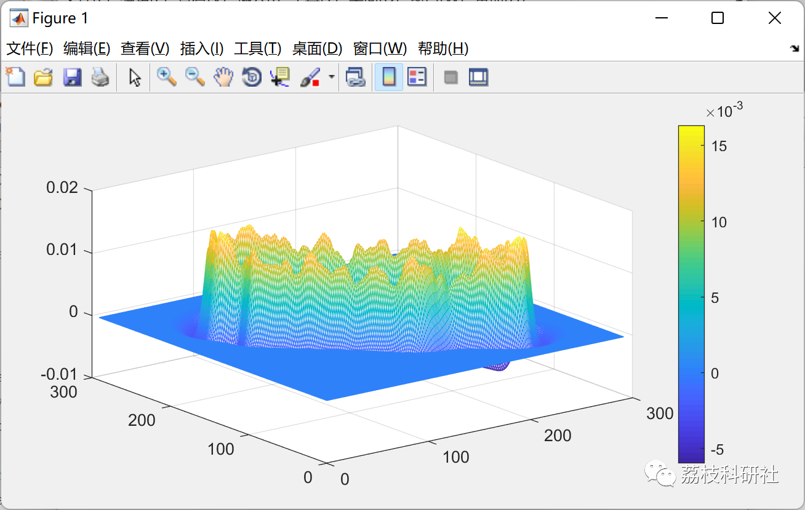
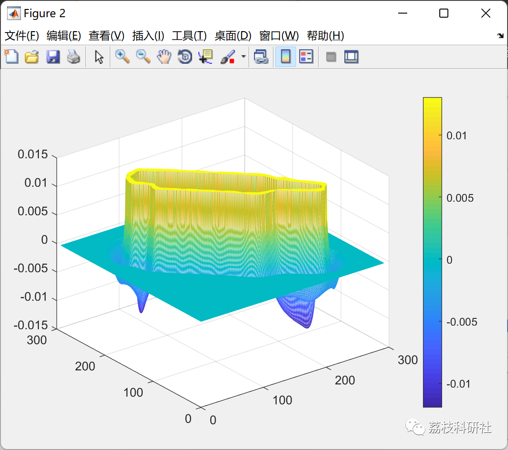
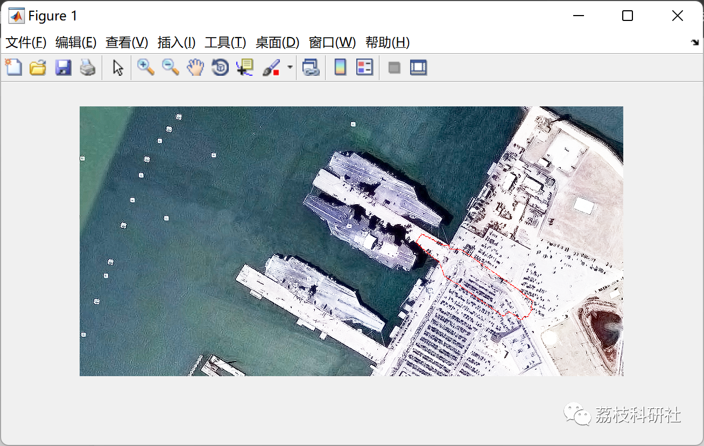
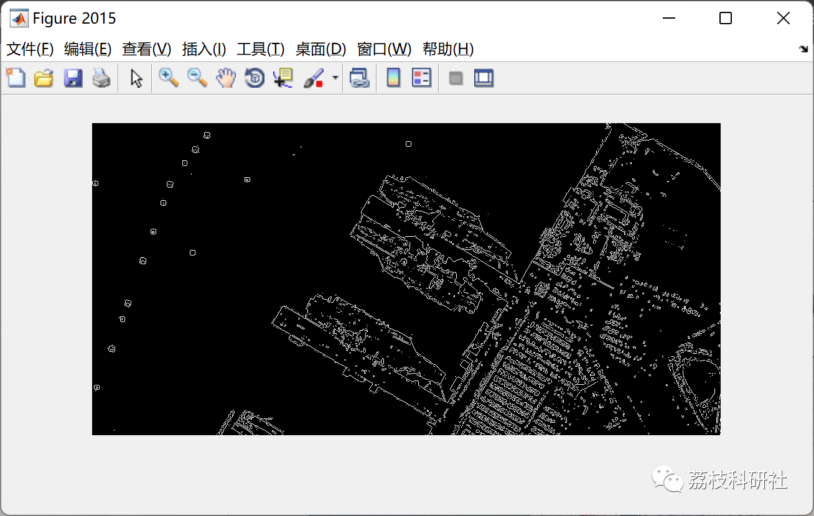
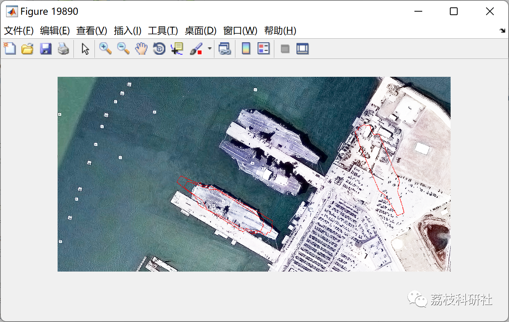

# Optimization of shape matching based on atomic potential function and artificial bee colony algorithm (Matlab code implementation)

💥💥💥💞💞💞 Welcome to this blog❤️❤️❤️ 💥💥💥
🏆 Bloggers' Advantages: 🌞🌞🌞 The content of the blog strives for rigorous thinking and clear logic, making it convenient for readers.
⛳️ Mantra: A journey of a thousand miles is begun with a single step.
Litchi Research Society
Code Collection: Power Systems, Intelligent Algorithms and Applications, Neural Network Prediction, Path Planning, Optimal Scheduling, Workshop Scheduling, Image Processing, Signal Processing...
🎁 Special Section Link: ​
🌈🌈🌈🌟🌟🌟 Electrical Code Drone and Physical Applications Path Planning Intelligent Algorithms and Their Applications Optimal Scheduling Neural Network Prediction Workshop Scheduling Image Processing Romantic Her Signal Processing Mathematical Modelling My Philosophical Thoughts Complete Code Issues
💥1 Overview
When observing the surrounding environment, people first notice the color, texture, shape, and spatial relationships of objects, among others. Shape is one of the most perceptually meaningful characteristics of an object. In computer vision and pattern recognition, shape represents a binary image of the target range, which can be seen as the contour of the target and is an important feature for target recognition. To save storage space and facilitate feature computation, further representation of shape is needed, which can generally be divided into two categories: encoding methods such as chain codes, run-length codes, Freeman codes etc.; Simplification methods such as splines (B-spline, 3rd degree·5th degree spline cubic interpolation, polynomial approximation, polygon approximation, and feature point detection etc. Additionally, the shape can also be described by its skeleton.
📚2 Running Results
🎉3 References
[1] Bai Li and Yuan Yao, "An Edge-based Optimization Method for Shape Recognition Using Atomic Potential Function", Engineering Applications of Artificial Intelligence, no. 35, pp. 14–25, 2014.
[2] Bai Li, Raymond Chiong and Mu Lin, "A Balance-Evolution Artificial Bee Colony Algorithm for Protein Structure Optimization Based on a Three-dimensional AB Off-Lattice Model", Computational Biology and Chemistry, no. 54, pp. 1–12, 2015.
👨‍💻4 Matlab code implementation
Click the article's lower left corner to read in full.

## Images

<!-- PAYMENT_BLOCK -->

## Get this dataset

- Payment link (Stripe): [Buy now](https://buy.stripe.com/3cs8yP7sY87d0vu9AB)
- Payment QR code: 

<!-- /PAYMENT_BLOCK -->
